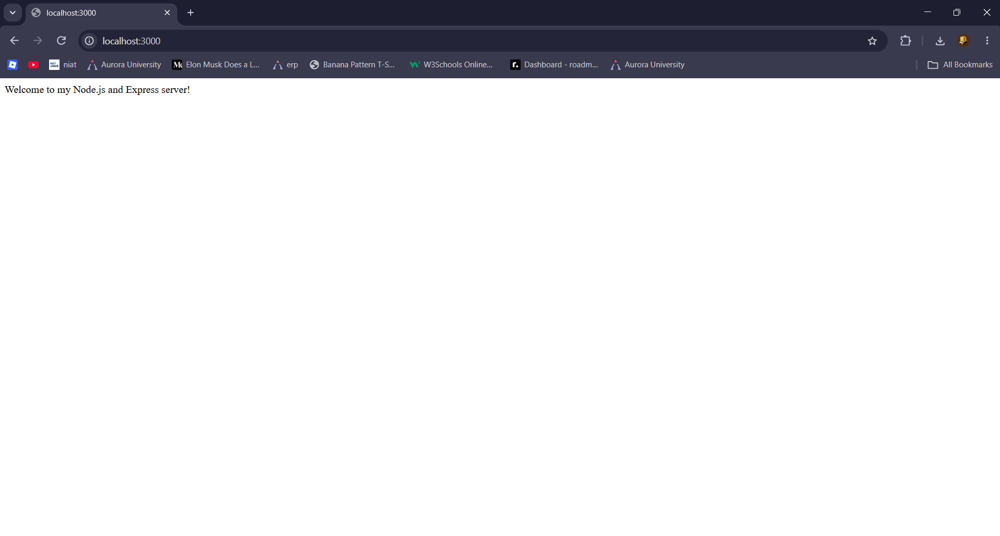
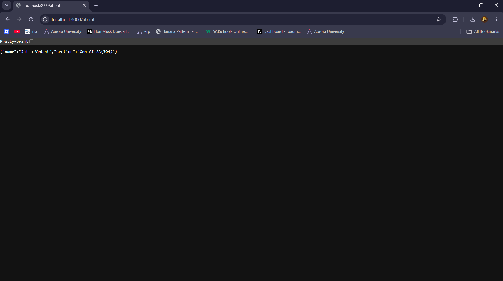
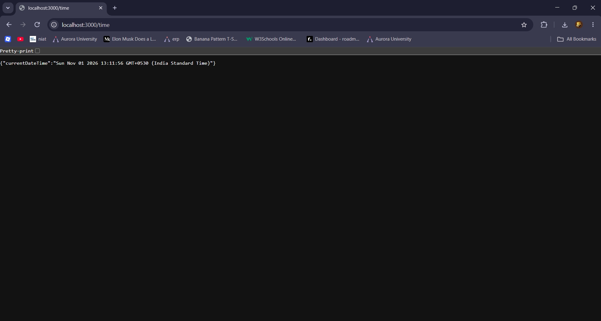
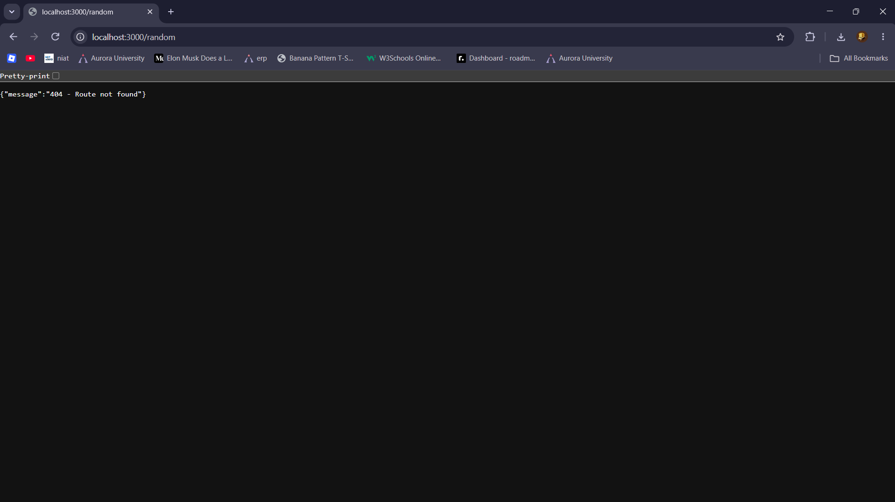

# Lab 1: Node.js and Express server

**Name:** Juttu Vedant  
**Registration number:** 252U1R9048  
**Section:** GEN AI 2A(304)

## Live Link

https://bdf-lab-01-vedant.onrender.com

## Objective

Create a Node.js project, first use the built-in `http` module to make a basic server, and then use Express to create routes.

## Requirements

- Node.js and npm installed
- A terminal (VS Code terminal is suitable)

## How to install and run

1. Open a terminal in this folder.
2. Install dependencies:

   ```bash
   npm install
   ```

3. Start the Express server:

   ```bash
   npm start
   ```

4. Open `http://localhost:3000` in your browser.

### Run the plain Node.js HTTP server (Task 3)

Stop the Express server with `Ctrl + C`, then run:

```bash
npm run start:http
```

The plain HTTP server also uses port 3000, so do not run both servers at the same time.

## Endpoints

| Method | Path | Description | Expected status |
|---|---|---|---|
| GET | `/` | Returns a welcome message | 200 |
| GET | `/about` | Returns name and section as JSON | 200 |
| GET | `/time` | Returns the current date and time | 200 |
| GET | Any unknown path | Returns a not-found message | 404 |

## Screenshots

Save genuine screenshots of your running endpoints in this folder:

- `screenshots/home.png`
- `screenshots/about.png`
- `screenshots/time.png`
- `screenshots/404.png`

After adding them, you can display them here using:

```markdown




```

## package.json fields

- `name`: project/package name.
- `version`: current project version.
- `description`: short explanation of the project.
- `main`: main entry file.
- `scripts`: shortcut commands such as `npm start`.
- `keywords`: terms that describe the project.
- `author`: package author.
- `license`: package license.

## Problems faced and solutions

Add the problems you actually faced while completing the lab and how you solved them.

## Notes

- `package.json` records project metadata and dependencies.
- `node_modules` contains installed packages and must not be committed.
- `.gitignore` prevents `node_modules` and `.env` from being committed.
- Replace the sample name and section in `server.js` and the details at the top of this README before submission.
- Deploy the app using a platform such as Render or Railway, then add the public URL above. If you cannot deploy it, explain why and include Postman screenshots as required by the lab brief.
