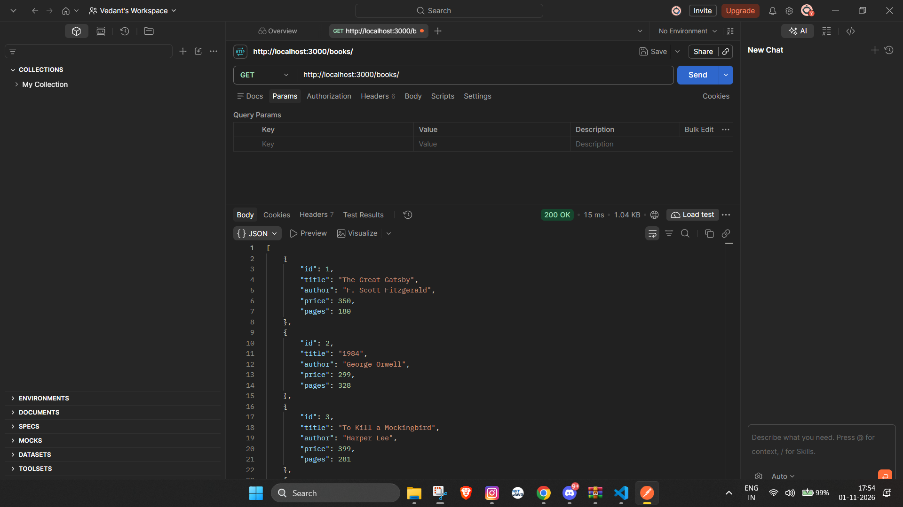
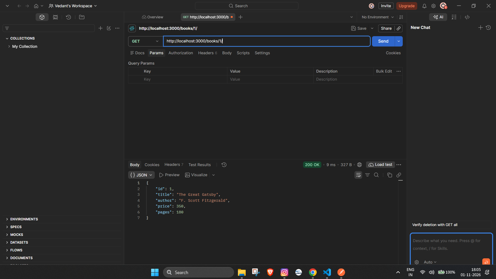
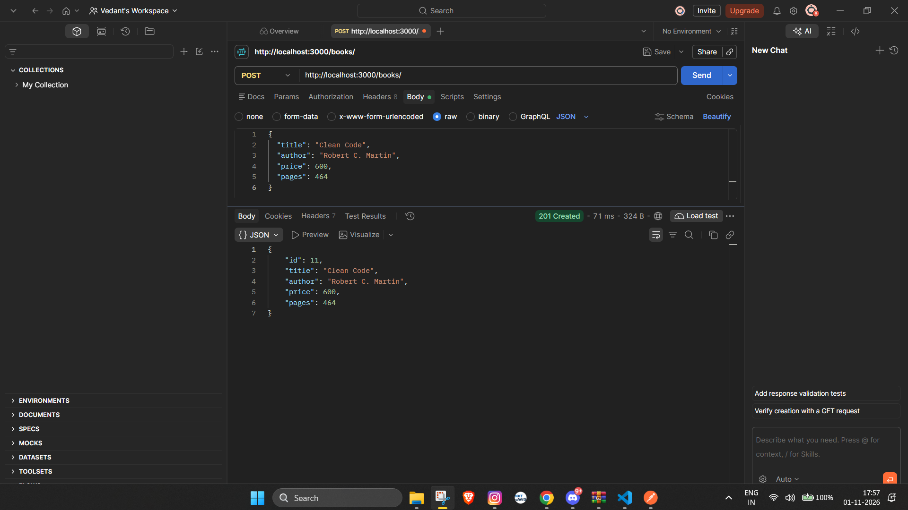
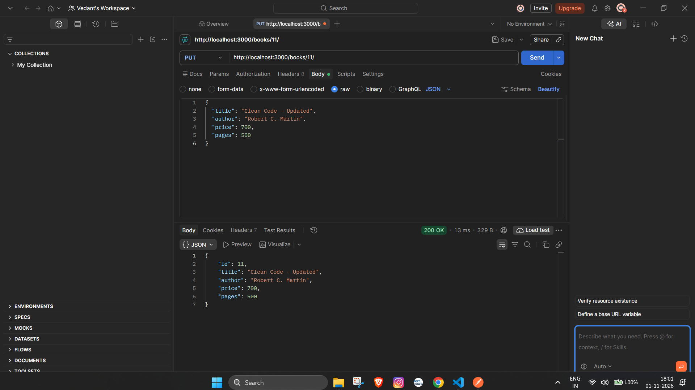
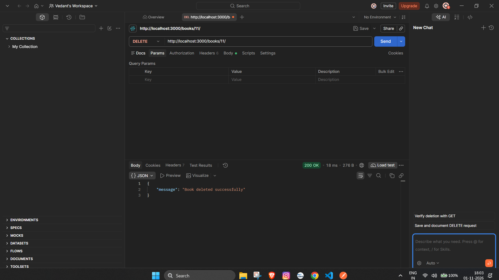

# Lab 2: SQLite database and CRUD routes

**Name:** Juttu Vedant  
**Registration number:** 252U1R9048  
**Section:** Gen AI 2A(304)

**Live link:** Add the Lab 2 deployment URL here after deployment.

## Objective
Connect an Express server to a SQLite database and expose CRUD operations over HTTP.

## Install and run
1. Open a terminal in this `lab-02` folder.
2. Run `npm install`.
3. Run `npm start`. The application opens `library.db`, creates the `book` table if needed, and starts the server after the database connection succeeds.
4. The included `library.db` contains 10 sample books. To inspect/seed them using SQLite CLI, stop the server with Ctrl+C, run `sqlite3 library.db`, then enter:
   ```sql
   .read db/seed.sql
   SELECT * FROM book;
   .quit
   ```
   The seed uses `INSERT OR IGNORE`, so repeating it will not duplicate the sample IDs.
5. Restart with `npm start`.

Nodemon restarts the server when files change. The server uses the platform `PORT` variable when available, otherwise port 3000. No other environment variables are required.

## Endpoints

| Method | Path | Description | Success status |
|---|---|---|---|
| GET | `/books/` | Get all books | 200 |
| GET | `/books/:bookId/` | Get one book | 200 |
| POST | `/books/` | Add a book | 201 |
| PUT | `/books/:bookId/` | Update a book | 200 |
| DELETE | `/books/:bookId/` | Delete a book | 200 |

Unknown book IDs return 404. Incomplete POST/PUT bodies return 400.

### Example JSON body for POST and PUT
Choose **Body → raw → JSON** in Postman:
```json
{
  "title": "Clean Code",
  "author": "Robert C. Martin",
  "price": 600,
  "pages": 464
}
```

## Parameterized queries
Queries that use request input pass values separately using `?` placeholders to help prevent SQL injection.

## Screenshots
Save genuine Postman screenshots for all five endpoints and a SQLite CLI view in `screenshots/`:
- `get-all-books.png`
- `get-one-book.png`
- `post-book.png`
- `put-book.png`
- `delete-book.png`
- `sqlite-rows.png`

Embed them here after capturing:
```markdown






```

## Problems faced and solutions
Add any actual problems you encounter and how you solved them.

## Viva questions
- **Why await the database call?** So the database operation completes before dependent work or the HTTP response.
- **What is SQL injection and how do placeholders prevent it?** SQL injection is when untrusted input changes a query's meaning. Placeholders bind values separately from SQL code.
- **When is PUT used instead of POST?** PUT updates an existing resource; POST creates a resource in this lab.

## Notes
- `initializeDBAndServer()` opens the database and creates the table before starting Express.
- Do not commit `node_modules` or `.env`.
- `library.db` is included as the database output for this lab.
